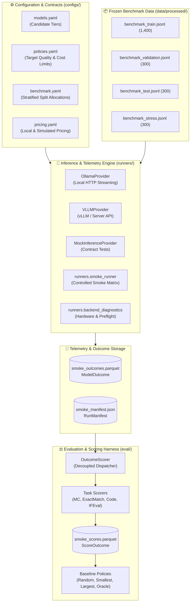

<div align="center">

# 🧭 Cost-Aware LLM Router

**Quality-constrained routing across local Qwen3 models — send each prompt to the cheapest model likely to answer it well.**


</div>

---

## 📌 Table of Contents

1. [Overview](#-overview)
2. [Project Status](#-project-status)
3. [Architecture](#-architecture)
4. [Candidate Model Tiers](#-candidate-model-tiers)
5. [Hardware & Local Inference Telemetry](#-hardware--local-inference-telemetry)
6. [Benchmark Design & Provenance](#-benchmark-design--provenance)
7. [Inference & Outcome Storage](#-inference--outcome-storage)
8. [Scoring & Baseline Infrastructure](#-scoring--baseline-infrastructure)
9. [Repository Structure](#-repository-structure)
10. [Getting Started](#-getting-started)
11. [CLI & Runner Commands](#-cli--runner-commands)
12. [Testing & Verification](#-testing--verification)
13. [Roadmap](#-roadmap)

---

## 🎯 Overview

Running every prompt through the largest available model is computationally wasteful: many queries can be answered with equivalent quality by a smaller, faster model. This project builds an empirical, research-grade **cost-aware LLM router** that dynamically dispatches each prompt to the cheapest candidate model capable of meeting a configurable quality threshold.

### Core Principles
- **100% Local Inference & Zero Cloud Spend**: Evaluates models on local consumer hardware using Ollama without third-party API dependencies.
- **Empirical Routing**: Learns decision boundaries over genuine task performance rather than heuristic token-count proxies.
- **Frozen Benchmark**: 2,300 stratified prompts across 11 diverse tasks, cryptographically sealed with SHA-256 verification.
- **Telemetry Integrity**: Strict separation between inference failures and quality scores. Unscorable or timed-out prompts are tracked explicitly rather than silently coerced to zero.

---

## 🚦 Project Status

| Phase | Milestone | Scope | Status |
| :--- | :--- | :--- | :--- |
| **Phase 1** | **Benchmark Freezing** | Ingestion pipeline for 11 datasets, split allocation (1,400 train / 300 val / 300 test / 300 stress), SHA-256 sealing | ✅ **Completed** |
| **Phase 2** | **Inference Infrastructure** | `ModelOutcome` & `RunManifest` schemas, Parquet storage, retry accounting, error taxonomy, vLLM & Mock providers | ✅ **Completed** |
| **Phase 3** | **Scoring & Baselines** | Decoupled `OutcomeScorer`, task-specific metrics (EM, MC, Code, IFEval, Rouge), 4 baseline policies | ✅ **Completed** |
| **Phase 4A–4E** | **Ollama Backend Integration** | Local Windows-native Ollama provider, model acquisition, real inference diagnostics for Qwen3-1.7B | ✅ **Completed** |
| **Phase 4F** | **3-Model Validation & Smoke Matrix** | Full acquisition (`qwen3:1.7b`, `qwen3:4b`, `qwen3:8b`), hardware telemetry, 15-prompt smoke matrix & scoring | ✅ **Completed** |
| **Phase 4G** | **Thinking Mode & Budget Rectification** | Native Ollama `/api/chat` integration (`think: false`), task-specific token budgets, truncation detection, 8B timeout resolution | ✅ **Completed** |
| **Phase 5** | **Candidate Inference Matrix** | Systematic collection of all candidate model evaluations on benchmark splits | ⏳ *Next Phase* |
| **Phase 6** | **Router Training & Serving** | Classifier / regressor training, Pareto frontier calibration, FastAPI deployment | ⏳ *Planned* |

---

## 🏗️ Architecture



---

## 🤖 Candidate Model Tiers

The candidate pool consists of three local instruction-tuned models from the **Qwen3** family, selected to represent distinct trade-offs between speed, memory footprint, and reasoning depth:

| Internal Model ID | Ollama Tag | Role | Parameters | Quantization | Size on Disk | Primary Target |
| :--- | :--- | :--- | :--- | :--- | :--- | :--- |
| `qwen3-1.7b` | `qwen3:1.7b` | Cheap Tier | 2.04 B | `Q4_K_M` | 1.27 GB | High-throughput, simple categorization, factual extraction |
| `qwen3-4b` | `qwen3:4b` | Middle Tier | 4.02 B | `Q4_K_M` | 2.33 GB | Balanced general reasoning, structured instruction following |
| `qwen3-8b` | `qwen3:8b` | Quality Anchor | 8.19 B | `Q4_K_M` | 4.87 GB | Complex mathematical derivations, multi-step code generation |

---

## 💻 Hardware & Local Inference Telemetry

All inference is executed natively on Windows 11 without cloud dependencies:
- **GPU**: NVIDIA GeForce RTX 3050 Laptop GPU (4,096 MiB dedicated GDDR6 VRAM)
- **RAM**: 16 GB DDR5 system memory (~15.7 GB visible)
- **Inference Engine**: Ollama daemon (`http://127.0.0.1:11434`)

### Observed Resource Allocations & Offload Profiles

```
+-----------------------------------------------------------------------------------------+
| Model       | Memory Placement            | Generation Speed  | Preflight Warm Latency  |
+-----------------------------------------------------------------------------------------+
| qwen3:1.7b  | 100% Dedicated GPU VRAM    | ~50 - 100 tok/s   | 2.75 s                  |
| qwen3:4b    | 100% Dedicated GPU VRAM    | ~25 - 30 tok/s    | 2.14 s                  |
| qwen3:8b    | Hybrid GPU (2.3GB) + CPU   | ~9.16 tok/s       | 42.88 s                 |
+-----------------------------------------------------------------------------------------+
```

### Thinking Mode & Output Budget Policy (Phase 4G)

Qwen3 models by default emit extended `<think> ... </think>` internal reasoning loops that can produce 2,000+ reasoning tokens per prompt, leading to severe latency and timeouts on hybrid CPU-offloaded models (`qwen3:8b`).

In Phase 4G, the inference layer was upgraded to:
1. **Native Ollama `/api/chat` Protocol**: Bypasses the OpenAI compatibility layer to reliably enforce top-level `"think": false` for benchmark tasks (MC, QA, classification, extraction), eliminating reasoning token overhead.
2. **Task-Appropriate Output Budgets**: Dynamically sets `options.num_predict` per task type (e.g., 768 for `multiple_choice`, 512 for `exact_match`, 128 for `classification`).
3. **Strict Truncation Detection**: Models that exhaust their output budget without finishing receive execution status `TRUNCATED`, with `is_truncated = True`. Truncated outputs are recorded as `SCORING_UNAVAILABLE` with `quality_score = None`, preventing incomplete generations from polluting benchmark evaluations.

#### Phase 4G Validation Matrix (5 Train Prompts × 3 Models)

| Candidate Model | Success Rate | Timeout Rate | Truncation Rate | Median Output Tokens | Median Warm Latency | Scored Quality |
| :--- | :---: | :---: | :---: | :---: | :---: | :---: |
| **`qwen3:1.7b`** | **100% (5/5)** | **0% (0/5)** | **0% (0/5)** | 379 tokens | **5.79 s** | **1.00 (5/5)** |
| **`qwen3:4b`** | **0% (0/5)** | **0% (0/5)** | **100% (5/5)** | 768 tokens (capped) | **23.46 s** | N/A *(Guarded)* |
| **`qwen3:8b`** | **100% (5/5)** | **0% (0/5)** | **0% (0/5)** | 456 tokens | **48.79 s** | **1.00 (5/5)** |

*Key Result*: `qwen3:8b` timeouts were completely resolved (0 timeouts, 0 retries, latencies ~44–74s vs. >120s timeout in 4F), while `qwen3:4b` verbosity was successfully trapped and guarded from corrupting evaluation scores.

---

## 📊 Benchmark Design & Provenance

The evaluation benchmark contains **2,300 prompts** balanced across 11 source datasets, stratified into 4 deterministic splits:

```
Total: 2,300 prompts
├── Train Split:      1,400 prompts (60.9%)  — Used exclusively for router training & candidate matrix
├── Validation Split:   300 prompts (13.0%)  — Used exclusively for router threshold calibration
├── Test Split:         300 prompts (13.0%)  — Held-out for final router Pareto evaluation
└── Stress Split:       300 prompts (13.0%)  — Robustness evaluation (held-out domain + perturbations)
```

### Dataset Distribution
1. **Mathematics**: GSM8K, MATH
2. **Code Generation**: HumanEval, MBPP
3. **Reasoning & Multi-hop**: BBH (Big-Bench Hard)
4. **General Knowledge**: MMLU (Abstract Algebra, Elementary Math, College Physics, etc.)
5. **Instruction Following**: IFEval
6. **Reading Comprehension & QA**: BoolQ, SuperGLUE (MultiRC, BoolQ)
7. **Summarization**: CNN/DailyMail
8. **Commonsense Reasoning**: HellaSwag
9. **Held-out Stress Domain**: SuperGLUE ReCoRD (completely excluded from core splits)

### Cryptographic Benchmark Hashes (Frozen)

| Split File | SHA-256 Checksum |
| :--- | :--- |
| `data/processed/benchmark_train.jsonl` | `ff956efaef264ce3ba9cd71992cb6a6de27de2484b4cd49f82619e2a4f4be014` |
| `data/processed/benchmark_validation.jsonl` | `5e6849452b6a22e69a4bc095fa2dff85820a7b608c86eb20a573eca644c1d143` |
| `data/processed/benchmark_test.jsonl` | `ec3ab60f16838e514733d8c76448dd3cfc0d5b59d90b997675a4d6971f09eb1b` |
| `data/processed/benchmark_stress.jsonl` | `36a092c32deeccdbc64b57cf969f839bff89c5201efcb4be51c07f66b8fe5747` |

---

## 💾 Inference & Outcome Storage

Inference outcomes are persisted in snappy-compressed Apache Parquet format adhering strictly to Pydantic schemas:
- **`ModelOutcome`**: Canonical execution record (`prompt_id`, `model_id`, `run_id`, `status`, `generated_text`, `latency_ms`, `prompt_tokens`, `output_tokens`, `input_cost_usd`, `output_cost_usd`, `attempt_history`).
- **`RunManifest`**: Execution metadata logging candidate models, checksums, prompt counts, and aggregate telemetry availability.
- **`ScoreOutcome`**: Scorer evaluation linked to each outcome via `canonical_key = f"{prompt_id}:{model_id}:{run_id}"`.

---

## ⚖️ Scoring & Baseline Infrastructure

### Decoupled Task Scorers
The scoring harness evaluates each model generation according to its task type:
- `multiple_choice`: Option letter and normalized answer alignment.
- `exact_match`: Whitespace and case-insensitive exact string match.
- `code_execution`: Isolated function validation (safe syntax/unit checking).
- `ifeval`: Verifiable rule checking (word counts, format tags, capitalization).
- `reference_based`: Token overlap and lexical metrics (Rouge / BLEU).

### Reference Baseline Policies
The routing system is evaluated against four canonical baselines:
1. **Always-Smallest (`qwen3-1.7b`)**: Minimum cost lower bound.
2. **Always-Largest (`qwen3-8b`)**: Maximum capability upper bound.
3. **Random Candidate**: Uninformed selection baseline.
4. **Oracle (Omniscient Router)**: Selects the cheapest candidate that succeeds on that specific prompt.

---

## 🗂️ Repository Structure

```
cost-aware-llm-router/
├── configs/
│   ├── benchmark.yaml          # Frozen dataset quotas and split rules
│   ├── models.yaml             # Candidate model definitions and limits
│   ├── policies.yaml           # Router quality thresholds and cost objectives
│   └── pricing.yaml            # Local and cloud token cost schedules
├── data/
│   ├── raw/                    # Raw source dataset caches (.gitignored)
│   ├── processed/              # Frozen benchmark JSONL splits
│   └── outcomes/               # Parquet outcome logs and run manifests
├── data_ingestion/             # Dataset adapters and ingestion runners
├── eval/
│   ├── scorers/                # Exact match, multiple choice, code, IFEval scorers
│   ├── scorer.py               # OutcomeScorer dispatcher
│   ├── scoring_schema.py       # ScoreOutcome Pydantic model
│   └── storage.py              # Parquet scoring storage with uniqueness checks
├── router/
│   ├── benchmark_config.py     # Benchmark configuration validator
│   ├── benchmark_loader.py     # Streaming JSONL benchmark parser
│   ├── benchmark_schema.py     # Canonical BenchmarkPrompt schema
│   ├── config.py               # ModelRegistry loader
│   └── policy_config.py        # PolicyConfig loader
├── runners/
│   ├── backend_diagnostics.py  # Local Ollama / vLLM hardware preflight tool
│   ├── inference.py            # Base provider interface, retry & cost accounting
│   ├── inference_policy.py     # Task-appropriate token budgets & thinking-mode policies
│   ├── ollama_runner.py        # Production Ollama HTTP provider (native /api/chat)
│   ├── outcome_schema.py       # ModelOutcome & RunManifest schemas with truncation guards
│   ├── smoke_runner.py         # Configurable matrix smoke runner
│   ├── storage.py              # Parquet outcome reader & writer
│   └── vllm_runner.py          # vLLM provider and MockInferenceProvider
├── tests/                      # 257 unit and integration tests
├── pyproject.toml              # Build system, dependencies, and pytest configuration
└── README.md                   # Project documentation
```

---

## 🚀 Getting Started

### 1. Environment Setup

```powershell
# Clone the repository
git clone https://github.com/vVIBHORj/cost-aware-LLM-router.git
cd cost-aware-llm-router

# Create virtual environment and install dependencies
python -m venv .venv
.venv\Scripts\Activate.ps1
pip install -e .
```

### 2. Ollama Setup & Candidate Acquisition

Download and start [Ollama](https://ollama.com/), then pull the candidate models:

```powershell
ollama pull qwen3:1.7b
ollama pull qwen3:4b
ollama pull qwen3:8b
```

---

## 💡 CLI & Runner Commands

### Backend Diagnostics & Preflight Checks

Check installed model tags, endpoint connectivity, and hardware telemetry:

```powershell
# Query local Ollama service and hardware
.venv\Scripts\python -m runners.backend_diagnostics --backend ollama

# Run deterministic single-prompt preflight with thinking disabled
.venv\Scripts\python -m runners.backend_diagnostics --backend ollama --run-preflight --model-id qwen3-1.7b --no-think --max-output-tokens 32
```

### Running Controlled Smoke Matrix

Execute a quick, verified 15-prompt smoke matrix (5 train prompts $\times$ 3 models) with scoring, task-specific budgets, and thinking mode control:

```powershell
.venv\Scripts\python -m runners.smoke_runner --backend ollama --splits train --prompts-per-split 5 --score --timeout 120 --no-think --output-dir data/outcomes/smoke_phase4g
```

---

## 🧪 Testing & Verification

Run the full automated test suite:

```powershell
.venv\Scripts\python -m pytest
```

Verify frozen benchmark integrity:

```powershell
.venv\Scripts\python -c "import hashlib, pathlib; p = pathlib.Path('data/processed'); [print(f'{f}: {hashlib.sha256((p/f).read_bytes()).hexdigest()}') for f in ['benchmark_train.jsonl', 'benchmark_validation.jsonl', 'benchmark_test.jsonl', 'benchmark_stress.jsonl']]"
```

---

## 🗺️ Roadmap

- [x] **Phase 1**: Benchmark ingestion, dataset adaptation, stratified splitting, and cryptographic freezing.
- [x] **Phase 2**: Candidate inference infrastructure, telemetry tracking, retry limits, and Parquet storage.
- [x] **Phase 3**: Decoupled scoring harness, task metrics, and baseline policy definitions.
- [x] **Phase 4**: Local Windows GPU inference feasibility, Ollama provider integration, model acquisition, thinking-mode/output budget rectification, and smoke matrix validation.
- [ ] **Phase 5**: Full candidate evaluation across the 1,400 training prompts.
- [ ] **Phase 6**: Router model training (cost-quality Pareto optimization) and threshold calibration.
- [ ] **Phase 7**: Final evaluation on held-out test and stress splits.
- [ ] **Phase 8**: FastAPI routing microservice deployment.

