<div align="center">

# 🧭 Cost-Aware LLM Router

### Quality-constrained routing across local LLMs

**Route each prompt to the least expensive model that is likely to meet the required quality — without sending data to a cloud inference API.**


</div>

---

## 📚 Table of Contents

- [Overview](#-overview)
- [Why This Project Matters](#-why-this-project-matters)
- [Project Status](#-project-status)
- [System Architecture](#-system-architecture)
- [Request Routing: Intended Runtime Flow](#-request-routing-intended-runtime-flow)
- [Candidate Model Tiers](#-candidate-model-tiers)
- [Benchmark Design and Data Integrity](#-benchmark-design-and-data-integrity)
- [Inference Lifecycle and Telemetry](#-inference-lifecycle-and-telemetry)
- [Scoring and Baselines](#-scoring-and-baselines)
- [Hardware and Local Inference](#-hardware-and-local-inference)
- [Repository Structure](#-repository-structure)
- [Getting Started](#-getting-started)
- [Commands](#-commands)
- [Testing and Verification](#-testing-and-verification)
- [How Routing Quality Will Be Evaluated](#-how-routing-quality-will-be-evaluated)
- [Roadmap](#-roadmap)
- [Limitations and Reproducibility](#-limitations-and-reproducibility)

---

## 🎯 Overview

Sending every request to the largest available language model can waste compute, memory, latency, and — when using hosted APIs — money. Many prompts do not need the strongest model. A cost-aware router aims to select the **lowest-cost candidate that is expected to satisfy a configurable quality requirement**.

This repository builds the evaluation infrastructure for a local-first, empirical router using three instruction-tuned Qwen3 models served by Ollama. The project freezes a benchmark, runs controlled model evaluations, records inference outcomes and hardware telemetry, scores outputs with task-aware evaluators, and compares routing strategies against transparent baselines.

> **Current scope:** benchmark preparation, inference providers, telemetry, outcome storage, scoring, baseline definitions, and local Ollama validation are implemented. The trained routing policy and production serving layer remain roadmap items; this README does not imply that the final learned router is already deployed.

### Design principles

- **Local-first inference:** run candidate models on local hardware through Ollama, without requiring a paid third-party inference API.
- **Empirical decisions:** use observed task performance, latency, and measured cost rather than token-count heuristics alone.
- **Quality constraints:** route under a configurable quality target rather than minimizing cost at any quality level.
- **Frozen evaluation data:** use deterministic benchmark splits and SHA-256 checksums to detect accidental data changes.
- **Honest telemetry:** distinguish timeouts, failures, truncated generations, and unscorable outputs from genuine low-quality answers.
- **Reproducible comparisons:** compare learned routing with simple baselines and a per-prompt oracle reference.

## 💡 Why This Project Matters

| Common approach | Problem | Cost-aware approach |
|---|---|---|
| Always use the largest model | Can spend unnecessary compute on simple tasks | Use a smaller model when evidence suggests it is sufficient |
| Route by prompt length alone | Length is not a reliable measure of reasoning difficulty | Learn from task-specific outcomes and measured telemetry |
| Treat every failure as a score of zero | Mixes infrastructure failures with model quality | Record execution status separately from quality score |
| Tune and test on the same prompts | Can make results look better than they generalize | Keep train, validation, test, and stress splits separate |
| Report quality without latency or cost | Hides operational trade-offs | Track quality, latency, tokens, retries, and cost together |

---

## 🚦 Project Status

| Phase | Milestone | Scope | Status |
|---|---|---|---|
| 1 | Benchmark freezing | Dataset ingestion, deterministic split allocation, SHA-256 checksums | ✅ Completed |
| 2 | Inference infrastructure | Outcome/run schemas, providers, retries, error taxonomy, Parquet storage | ✅ Completed |
| 3 | Scoring and baselines | Task-aware scorers and four baseline policy definitions | ✅ Completed |
| 4A–4E | Ollama backend integration | Windows-native local provider and real inference diagnostics | ✅ Completed |
| 4F | Three-model validation | Qwen3 1.7B/4B/8B acquisition, hardware telemetry, smoke evaluation | ✅ Completed |
| 4G | Thinking mode and output budgets | Native Ollama chat integration, task-specific token limits, truncation guards | ✅ Completed |
| 5 | Candidate inference matrix | Systematic evaluation of candidates on benchmark splits | ⏳ Next |
| 6 | Router training and serving | Train router, calibrate quality/cost trade-offs, expose a service | ⏳ Planned |
| 7 | Held-out evaluation | Final test and stress-split evaluation | ⏳ Planned |
| 8 | API deployment | FastAPI routing service and operational integration | ⏳ Planned |

---

## 🏗️ System Architecture

The repository is organized into configuration, frozen data, inference, outcome storage, and evaluation layers. The current implementation focuses on collecting trustworthy evidence for a router; the learned runtime policy is a later milestone.

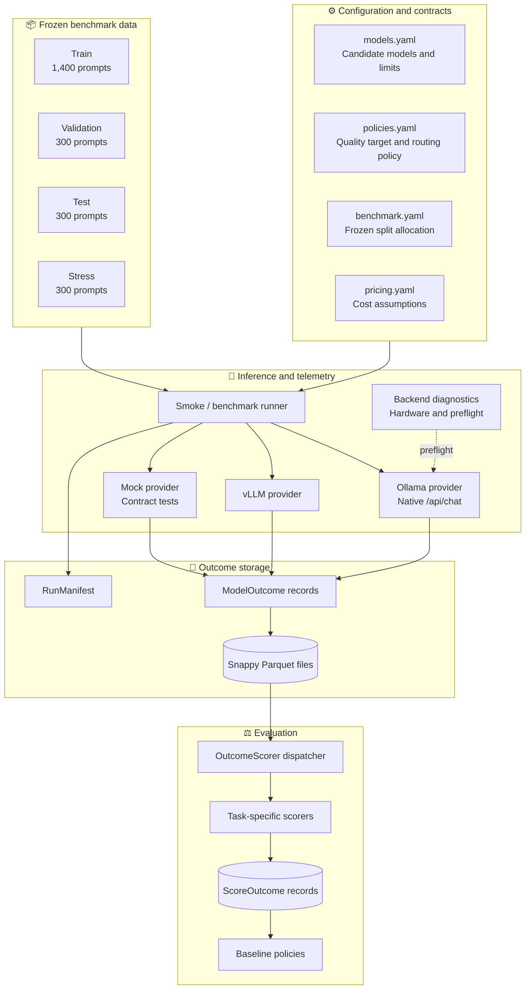

### 🧩 Main components

| Component | Responsibility |
|---|---|
| `configs/` | Declares candidate models, quality/cost policy, benchmark splits, and pricing assumptions |
| `data_ingestion/` | Adapts source datasets into a common benchmark representation |
| `router/` | Loads and validates benchmark/model/policy configuration and prompt schemas |
| `runners/` | Executes inference, handles provider contracts, retries, token budgets, and telemetry |
| `eval/` | Dispatches model outputs to task-specific scorers and persists scores |
| `data/processed/` | Stores the frozen benchmark splits |
| `data/outcomes/` | Stores generated outcomes, scoring data, and run manifests |
| `tests/` | Unit and integration tests for schemas, configuration, providers, storage, and scoring |

## 🔁 Request Routing: Intended Runtime Flow

The following diagram shows the **target routing decision flow**, not a claim that the trained router is already live. The upcoming candidate matrix and router-training phases will supply the empirical performance estimates used by this policy.

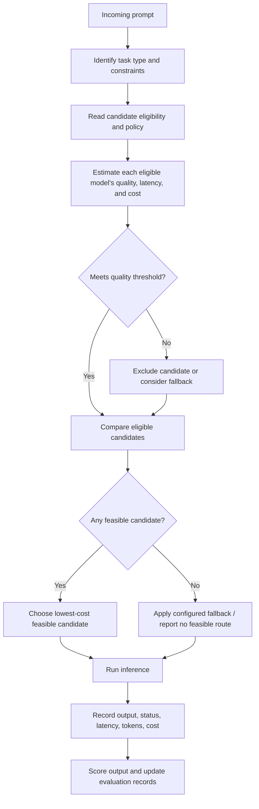

### Routing objective

Conceptually, the router seeks to minimize inference cost subject to a quality constraint:

\[
\min_{m \in \mathcal{M}} \; \mathbb{E}[C(m,x)]
\]

subject to:

\[
\mathbb{E}[Q(m,x)\mid \text{task}(x)] \geq \tau
\]

where:

- \(x\) is the incoming prompt,
- \(\mathcal{M}\) is the candidate model set,
- \(C(m,x)\) is the measured or configured cost of using model \(m\),
- \(Q(m,x)\) is the task-aware quality score,
- \(\tau\) is the configured minimum quality target.

In practice, the project also considers execution failures, truncation, latency limits, and the confidence of the estimated outcome. The exact objective and policy will be determined during router training and calibration.

## 🤖 Candidate Model Tiers

The current candidate pool uses three locally served Qwen3 models to represent different trade-offs between speed, memory footprint, and reasoning capability.

| Internal model ID | Ollama tag | Intended role | Parameters | Quantization | Approx. disk size | Typical use |
|---|---|---|---:|---|---:|---|
| `qwen3-1.7b` | `qwen3:1.7b` | Cheap tier | 2.04B | `Q4_K_M` | 1.27 GB | Simple categorization and factual extraction |
| `qwen3-4b` | `qwen3:4b` | Middle tier | 4.02B | `Q4_K_M` | General reasoning and structured instructions |
| `qwen3-8b` | `qwen3:8b` | Quality anchor | 8.19B | `Q4_K_M` | More complex mathematics and multi-step code tasks |

These are candidate roles, not guarantees that one model always wins on a particular task. The candidate inference matrix will measure the actual trade-offs on the frozen benchmark.

### Model selection spectrum

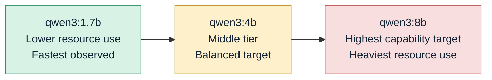

---

## 🧪 Benchmark Design and Data Integrity

The frozen benchmark contains **2,300 prompts** distributed across four deterministic splits.

| Split | Prompt count | Purpose | Allowed use |
|---|---:|---|---|
| Train | 1,400 | Candidate analysis and router training | Training and exploratory analysis |
| Validation | 300 | Threshold and policy calibration | Model/policy selection |
| Test | 300 | Final held-out evaluation | Final reporting only |
| Stress | 300 | Robustness checks, held-out domain, perturbations | Robustness reporting |
| **Total** | **2,300** | | |

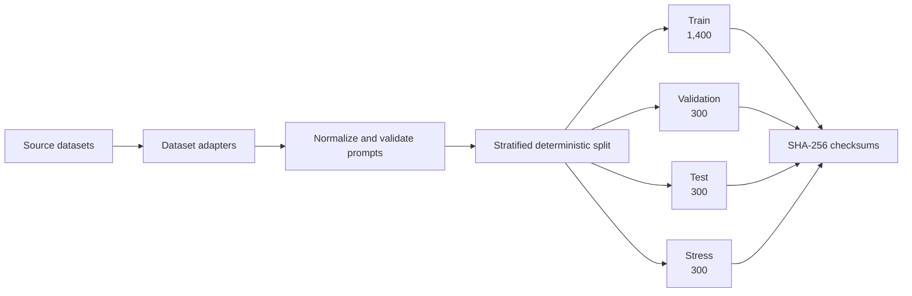

### Dataset families

The source benchmark covers multiple capabilities:

- **Mathematics:** GSM8K, MATH
- **Code generation:** HumanEval, MBPP
- **Reasoning and multi-hop tasks:** Big-Bench Hard (BBH)
- **General knowledge:** MMLU subject subsets
- **Instruction following:** IFEval
- **Reading comprehension and QA:** BoolQ and SuperGLUE tasks
- **Summarization:** CNN/DailyMail
- **Commonsense reasoning:** HellaSwag
- **Held-out stress domain:** SuperGLUE ReCoRD, excluded from the core splits

Exact dataset availability and licensing terms should be checked against each source before redistributing raw data. The repository is intended to store adapters and processed benchmark records according to the project's data policy, rather than automatically republish every upstream dataset.

### Frozen split checksums

The following SHA-256 hashes are recorded in the current project README. Recompute them against your local files before relying on them; any change to a file should change its hash.

| Split file | Recorded SHA-256 |
|---|---|
| `data/processed/benchmark_train.jsonl` | `ff956efaef264ce3ba9cd71992cb6a6de27de2484b4cd49f82619e2a4f4be014` |
| `data/processed/benchmark_validation.jsonl` | `5e6849452b6a22e69a4bc095fa2dff85820a7b608c86eb20a573eca644c1d143` |
| `data/processed/benchmark_test.jsonl` | `ec3ab60f16838e514733d8c76448dd3cfc0d5b59d90b997675a4d6971f09eb1b` |
| `data/processed/benchmark_stress.jsonl` | `36a092c32deeccdbc64b57cf969f839bff89c5201efcb4be51c07f66b8fe5747` |

### Avoiding evaluation leakage

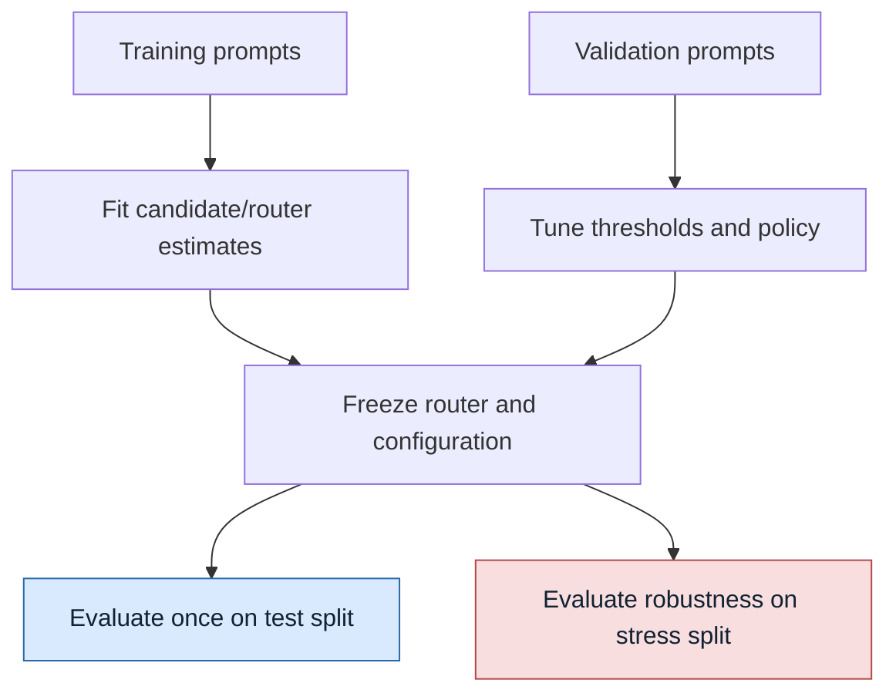

Do not use test or stress results to repeatedly tune the router. Keep the split boundaries intact to preserve a meaningful estimate of generalization.

---

## 📡 Inference Lifecycle and Telemetry

Each candidate run produces structured records instead of only printing a generated answer.

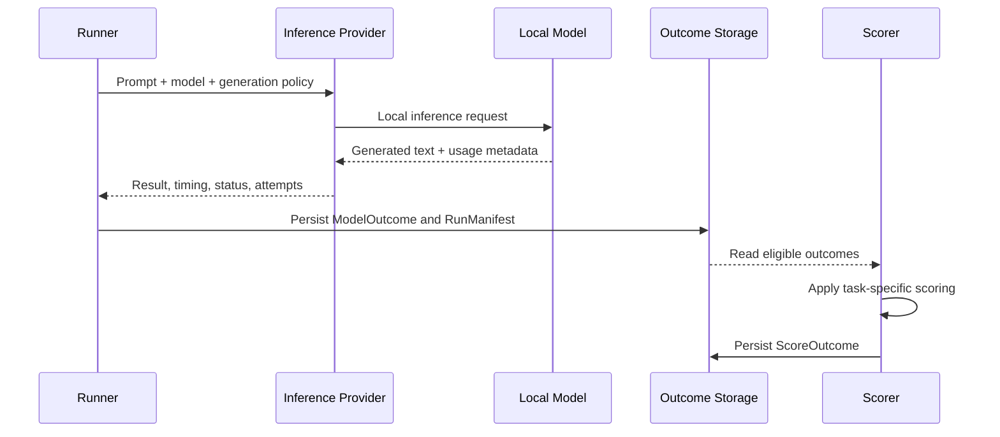

### Outcome records

- **`ModelOutcome`** — canonical execution record, including prompt/model/run identifiers, execution status, generated text, latency, token counts, cost fields, and attempt history.
- **`RunManifest`** — run-level metadata such as candidate models, dataset checksums, prompt counts, and telemetry availability.
- **`ScoreOutcome`** — score record linked to an outcome through a canonical key such as `prompt_id:model_id:run_id`.

Outcomes are persisted in Snappy-compressed Apache Parquet. Schemas and uniqueness checks help keep results consistent and analyzable.

### Failure and quality are separate

A timeout is not the same thing as a bad answer. Likewise, a truncated answer may not be fairly scoreable.

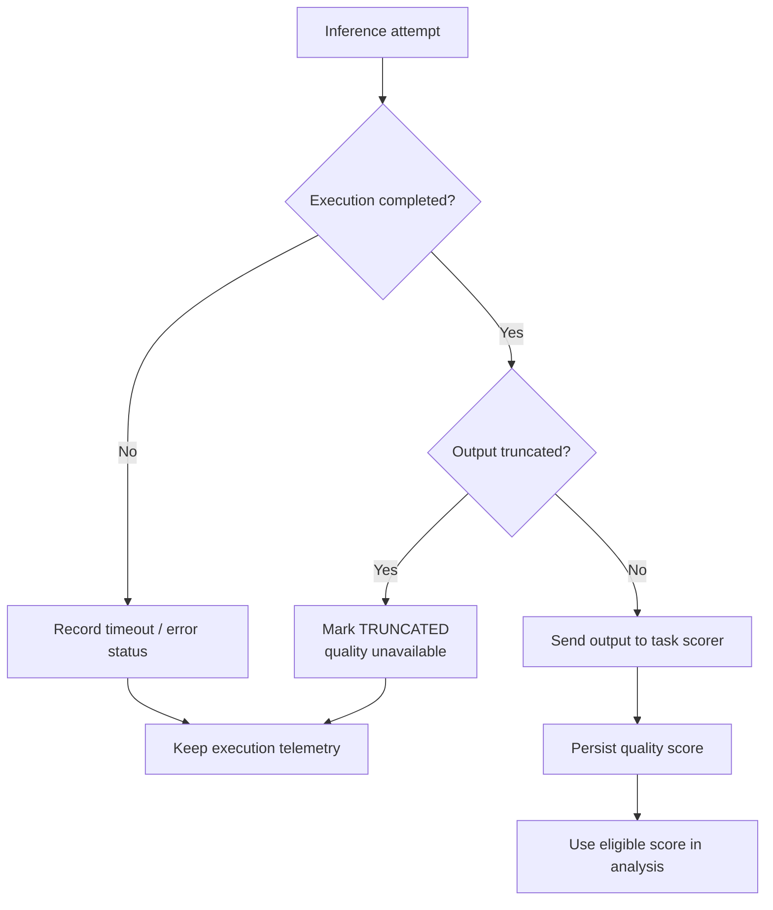

This avoids silently converting timeouts or incomplete generations into a zero-quality answer. In the current Phase 4G implementation, truncation is guarded and recorded with scoring unavailable (`quality_score = None`) rather than allowing incomplete outputs to corrupt model comparisons.

### Thinking mode and output budgets

Qwen3 can generate extended reasoning tokens. On a resource-constrained machine, this can increase latency and trigger timeouts. Phase 4G introduced:

1. Native Ollama `/api/chat` requests to control the top-level `think` setting.
2. Task-specific `num_predict` budgets.
3. Truncation detection and explicit status handling.
4. A smoke-evaluation workflow to inspect behavior before running a large matrix.

Example output budgets described in the project implementation include 768 tokens for multiple-choice tasks, 512 for exact-match tasks, and 128 for classification. These are policy examples and should be checked against the active configuration before changing them.

---

## ⚖️ Scoring and Baselines

### Task-aware scoring

The scoring harness dispatches each completed output to an evaluator appropriate for its task.

| Task family | Scoring approach |
|---|---|
| Multiple choice | Parse option/answer and compare normalized answer |
| Exact match | Compare normalized strings, ignoring case and irrelevant whitespace |
| Code execution | Validate code using isolated checks or task-specific test logic |
| Instruction following | Check verifiable rules such as word count, formatting, or capitalization |
| Reference-based generation | Use lexical/reference metrics such as ROUGE or BLEU where appropriate |

A single generic metric is not suitable for every task. A classification response, a code solution, and a summary need different scoring logic.

### Baseline policies

The router is designed to be compared against four baselines:

1. **Always-smallest (`qwen3-1.7b`)** — cost-oriented lower-bound reference.
2. **Always-largest (`qwen3-8b`)** — capability-oriented reference.
3. **Random candidate** — uninformed selection baseline.
4. **Oracle** — selects the cheapest candidate that succeeds for a particular prompt, using observed outcomes. This is an idealized reference, not a deployable router, because it relies on information that may not be available before inference.

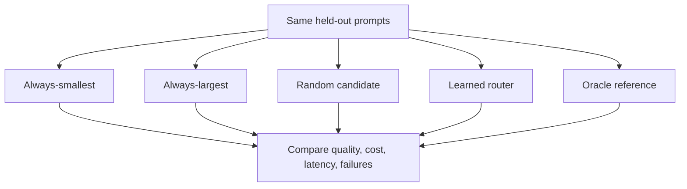

### Metrics to report

At minimum, the final comparison should report:

- Task-aware quality / success rate
- Average and median latency
- Input and output tokens
- Estimated or measured inference cost
- Timeout, error, retry, and truncation rates
- Percentage of prompts meeting the target quality
- Cost savings relative to always-largest
- Quality loss or gain relative to always-largest
- Pareto frontier of quality versus cost/latency

The router should not be judged on cost savings alone: a cheap policy that misses the quality requirement is not a successful result.

---

## 💻 Hardware and Local Inference

The original project notes report the following local environment. Treat performance numbers as machine- and configuration-specific, not universal model benchmarks.

- **OS:** Windows 11
- **GPU:** NVIDIA GeForce RTX 3050 Laptop GPU, reported as 4,096 MiB dedicated GDDR6 VRAM
- **System RAM:** 16 GB DDR5, approximately 15.7 GB visible
- **Inference engine:** Ollama at `http://127.0.0.1:11434`
- **Cloud inference spend:** none required for the local Ollama path

### Observed resource and latency profile

| Model | Reported placement | Observed generation speed | Reported preflight warm latency |
|---|---|---:|---:|
| `qwen3:1.7b` | 100% dedicated GPU VRAM | ~50–100 tokens/s | 2.75 s |
| `qwen3:4b` | 100% dedicated GPU VRAM | ~25–30 tokens/s | 2.14 s |
| `qwen3:8b` | Hybrid GPU/CPU offload | ~9.16 tokens/s | 42.88 s |

These are observations from the project environment and can vary with context length, prompt, temperature, quantization, model version, GPU load, and whether the model is already loaded. Re-run diagnostics on your own machine before making performance claims.

### Local-first inference path

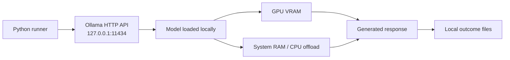

---

## 🗂️ Repository Structure

```text
cost-aware-llm-router/
├── configs/
│   ├── benchmark.yaml          # Frozen dataset quotas and split rules
│   ├── models.yaml             # Candidate model definitions and limits
│   ├── policies.yaml           # Quality thresholds and cost objectives
│   └── pricing.yaml            # Local and simulated pricing schedules
├── data/
│   ├── raw/                    # Raw source dataset caches (gitignored)
│   ├── processed/              # Frozen benchmark JSONL splits
│   └── outcomes/               # Parquet outcomes and run manifests
├── data_ingestion/             # Dataset adapters and ingestion runners
├── eval/
│   ├── scorers/                # Task-specific scorers
│   ├── scorer.py               # OutcomeScorer dispatcher
│   ├── scoring_schema.py       # ScoreOutcome Pydantic model
│   └── storage.py              # Parquet scoring storage and uniqueness checks
├── router/
│   ├── benchmark_config.py     # Benchmark configuration validation
│   ├── benchmark_loader.py     # Streaming JSONL benchmark parser
│   ├── benchmark_schema.py     # Canonical BenchmarkPrompt schema
│   ├── config.py               # ModelRegistry loader
│   └── policy_config.py        # PolicyConfig loader
├── runners/
│   ├── backend_diagnostics.py  # Ollama/vLLM preflight and hardware checks
│   ├── inference.py             # Provider interface, retry and cost accounting
│   ├── inference_policy.py      # Token budgets and thinking-mode policy
│   ├── ollama_runner.py         # Native Ollama /api/chat provider
│   ├── outcome_schema.py        # ModelOutcome and RunManifest schemas
│   ├── smoke_runner.py          # Configurable smoke-matrix runner
│   ├── storage.py               # Parquet outcome reader/writer
│   └── vllm_runner.py           # vLLM and mock provider implementations
├── tests/                       # Unit and integration tests
├── pyproject.toml               # Build metadata and dependencies
└── README.md                    # Project documentation
```

> This is the intended high-level structure documented by the project. If your local checkout has changed, use `tree` or your IDE's file explorer to verify exact paths before relying on a path listed here.

---

## 🚀 Getting Started

### Prerequisites

- Windows 11 or another supported Python environment
- Python 3.12
- Git
- Ollama installed and running
- Enough free disk space for the candidate models and benchmark artifacts

### 1. Clone and install

Open PowerShell:

```powershell
git clone https://github.com/vVIBHORj/cost-aware-LLM-router.git
cd cost-aware-LLM-router

python -m venv .venv
.venv\Scripts\Activate.ps1

python -m pip install --upgrade pip
pip install -e .
```

If PowerShell blocks virtual-environment activation, either review your local execution-policy settings or invoke the environment's Python directly:

```powershell
.venv\Scripts\python.exe -m pip install -e .
```

### 2. Install and start Ollama

Install [Ollama](https://ollama.com/), start its local service, and download the candidate models:

```powershell
ollama pull qwen3:1.7b
ollama pull qwen3:4b
ollama pull qwen3:8b
```

Confirm that the expected tags are available:

```powershell
ollama list
```

The local API normally listens at `http://127.0.0.1:11434`. If the service is not running, start Ollama using your installed platform's normal method.

### 3. Check backend readiness

```powershell
.venv\Scripts\python.exe -m runners.backend_diagnostics --backend ollama
```

Run a small deterministic preflight:

```powershell
.venv\Scripts\python.exe -m runners.backend_diagnostics --backend ollama --run-preflight --model-id qwen3-1.7b --no-think --max-output-tokens 32
```

### 4. Run a controlled smoke matrix

This command evaluates five training prompts against three models (15 model/prompt runs), with scoring and task-specific generation controls:

```powershell
.venv\Scripts\python.exe -m runners.smoke_runner --backend ollama --splits train --prompts-per-split 5 --score --timeout 120 --no-think --output-dir data/outcomes/smoke_phase4g
```

Review the generated run manifest, outcome Parquet file, and score output in the selected output directory.

---

## 🧰 Commands

### Common development commands

```powershell
# Activate environment
.venv\Scripts\Activate.ps1

# Run all tests
.venv\Scripts\python.exe -m pytest

# Run tests with verbose output
.venv\Scripts\python.exe -m pytest -v

# Check installed model tags
ollama list

# Check local Ollama endpoint and hardware
.venv\Scripts\python.exe -m runners.backend_diagnostics --backend ollama
```

### Verify frozen benchmark hashes

```powershell
.venv\Scripts\python.exe -c "import hashlib, pathlib; p = pathlib.Path('data/processed'); files = ['benchmark_train.jsonl', 'benchmark_validation.jsonl', 'benchmark_test.jsonl', 'benchmark_stress.jsonl']; [print(f'{name}: {hashlib.sha256((p/name).read_bytes()).hexdigest()}') for name in files]"
```

Compare the printed values with the checksum table above. If a file is missing or a checksum differs, investigate before running final evaluation.

### Example: backend diagnostics and smoke-run workflow

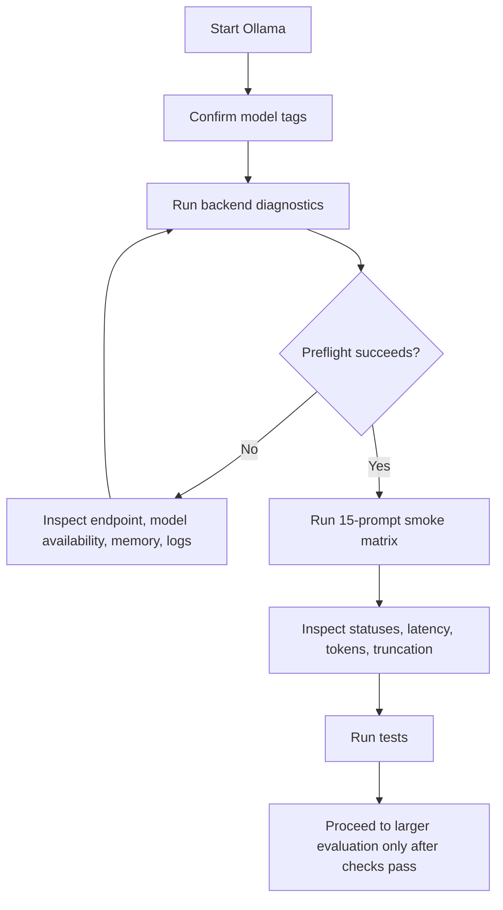

---

## ✅ Testing and Verification

Run the automated test suite:

```powershell
.venv\Scripts\python.exe -m pytest
```

The project has previously used unit and integration tests for areas such as:

- Configuration and schema validation
- Provider behavior and inference contracts
- Retry and execution-status handling
- Outcome and score storage
- Scoring dispatch and task-specific evaluators
- Benchmark split integrity
- Truncation and generation-budget safeguards

The exact test count can change as the codebase evolves. Use the output from the current checkout as the source of truth; do not rely on a hard-coded badge as proof that tests pass in a new environment.

---

## 📈 How Routing Quality Will Be Evaluated

A useful router should achieve a better quality/cost trade-off than simple policies, not just choose the smallest model more often.

### Quality–cost Pareto frontier

The final analysis should plot model/policy cost against quality. A point is Pareto-dominated if another policy is both cheaper and at least as good.

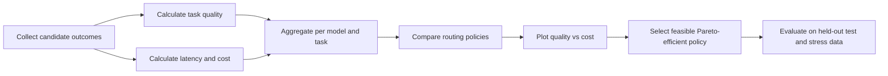

### Core success questions

1. Does the router meet the target quality threshold?
2. How much cost does it save relative to always using `qwen3:8b`?
3. What quality trade-off, if any, accompanies the savings?
4. How does routing affect median and tail latency?
5. Does the policy behave differently across task types?
6. How often do execution errors, timeouts, or truncated responses occur?
7. Does the result hold on held-out test and stress prompts?

---

## 🗺️ Roadmap

- [x] **Phase 1:** Benchmark ingestion, dataset adaptation, stratified splitting, and cryptographic freezing.
- [x] **Phase 2:** Inference provider contracts, telemetry, retry handling, and Parquet outcome storage.
- [x] **Phase 3:** Task-aware scoring harness and baseline policy definitions.
- [x] **Phase 4:** Local Ollama integration, model acquisition, hardware diagnostics, output-budget controls, and smoke validation.
- [ ] **Phase 5:** Evaluate the full candidate matrix on the training split.
- [ ] **Phase 6:** Train routing models and calibrate quality/cost thresholds using validation data.
- [ ] **Phase 7:** Evaluate the frozen policy on test and stress splits.
- [ ] **Phase 8:** Implement and deploy a FastAPI routing service.

---

## ⚠️ Limitations and Reproducibility

- **Local hardware limits:** model speed and memory placement depend on the machine, model build, quantization, and prompt length.
- **Estimated versus real cost:** local inference has no per-token cloud invoice, so cost comparisons must clearly distinguish measured resource usage, configured simulated prices, and actual monetary spend.
- **Scoring limitations:** automatic metrics are imperfect proxies for human-perceived quality. Report task-specific scores and evaluator limitations.
- **Oracle is an upper-bound reference:** it uses observed per-prompt outcomes and is not available as a normal pre-inference policy.
- **Benchmark provenance matters:** keep dataset versions, adapters, split rules, and checksums recorded.
- **Do not overstate current completion:** the infrastructure and local inference validation are in place, but the learned router, full matrix evaluation, held-out results, and API deployment are roadmap work.

## 🤝 Contributing

For changes to the benchmark or evaluation logic:

1. Keep benchmark schemas and split rules explicit.
2. Add tests for new providers, statuses, scorers, and edge cases.
3. Preserve the separation between execution status and quality score.
4. Avoid tuning against the test or stress splits.
5. Update this README when the implemented behavior or CLI changes.


<div align="center">

**Built to study the practical trade-off between LLM quality, inference cost, and latency.**

</div>
